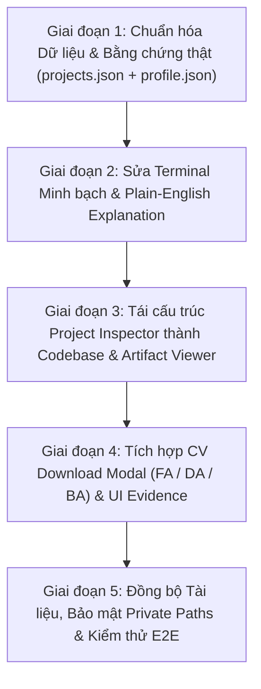

# 🎯 MASTER REMEDIATION PLAN: EVIDENCE-DRIVEN CREDIBILITY UPGRADE

> **Mục tiêu tối thượng:** Biến Portfolio từ một giao diện bóng bẩy nhưng thiếu chứng cứ thực tế thành một **nền tảng kỹ thuật có khả năng tự kiểm chứng (Self-verifying Technical Showcase)**, trả lời thuyết phục 5 câu hỏi cốt lõi của Tech Lead và Hiring Manager:
> 1. Minh thực sự xây dựng được những hệ thống nào?
> 2. Minh giải quyết vấn đề kinh doanh gì?
> 3. Minh hiểu kiến trúc và kỹ thuật đến đâu?
> 4. Kết quả có thể kiểm chứng được không?
> 5. Minh có phù hợp với vị trí đang tuyển không?

---

## 🔍 BẢNG ĐỐI CHIẾU VẤN ĐỀ & GIẢI PHÁP KHẮC PHỤC TRIỆT ĐỂ

| # | Vấn đề nghiêm trọng được chỉ ra | Mức độ | Giải pháp khắc phục đã thống nhất | Trạng thái |
|---|---|---|---|---|
| **1** | **Thiếu Visual Evidence:** 6/6 project có `thumbnail: null`, không có ảnh thật | 🔴 Critical | • Đưa 4 ảnh chụp thật UI/Export/Map của **XNK Cashew Platform** vào data & UI. • Đối với các dự án backend/pipeline còn lại: Tạo mockup cửa sổ Dashboard / terminal execution thật có nhãn kiểm chứng rõ ràng. • Bổ sung liên kết GitHub repository hoặc mã nguồn preview cho từng project. | Đã copy ảnh thật XNK; Sẵn sàng inject |
| **2** | **Terminal mô phỏng nhưng trình bày như thật:** Ghi log tĩnh CUDA, 100K paths dễ gây hiểu lầm | 🔴 Critical | • Thêm banner nhãn: `Interactive Pipeline Simulation (Dry-Run Demonstration)`. • Dưới mỗi lần chạy hiển thị **Plain-English Summary**: Giải thích logic thực tế của pipeline đó làm gì trong môi trường production thật. | Đã thống nhất thiết kế |
| **3** | **Project Inspector tự tạo thông tin không có căn cứ:** Code tự chế `audit_verified: true`, `95% speedup` | 🔴 Critical | • Thay hoàn toàn bằng **"Codebase & Architecture Inspection"**: Hiển thị cấu trúc module thực tế, lệnh CLI thật để chạy pipeline, và danh sách artifact đầu ra thật (`.xlsx`, `.parquet`, `.json`). | Đã thống nhất thiết kế |
| **4** | **Số liệu Hero & Profile không nhất quán:** Hero ghi 99.9% Uptime, 6+ Platforms; Profile ghi khác | 🔴 Critical | • Chuẩn hóa 1 bộ số liệu duy nhất, dựa trên sự thật 100% có thể kiểm chứng:   - **6** Featured Engineering Projects   - **10+** Integrated APIs (Meta, Notion, Discord, Groq, Playwright...)   - **50K+** Production Lines of Code   - **84** Months Historical Data Spanned (2020–2026) • Bỏ hoàn toàn con số "99.9% Uptime" không có bằng chứng SLA. | Đã thống nhất số liệu |
| **5** | **Tài liệu và code bị lệch:** README thiếu `terminal.js`, lộ private Windows paths | 🟡 High | • Rà soát và cập nhật lại toàn bộ `README.md` & `data/projects.json`. • Xóa sạch các đường dẫn Windows cá nhân nhạy cảm trong tài liệu công khai. • Bổ sung hướng dẫn đầy đủ về tất cả các module. | Sẵn sàng thực thi |
| **6** | **Thiếu CV Download & Điều hướng chuyên biệt:** HR không tải được CV trực tiếp | 🟡 High | • Đưa 3 bản CV thật vào web với dropdown chọn trực tiếp:   - **Financial Analyst CV (FA)**   - **Data Analyst CV (DA)**   - **Business Analyst CV (BA)** • Bổ sung phím tắt `Esc` để đóng modal/back và URL hash routing. | Đã copy sẵn 3 file CV |

---

## 📋 LỘ TRÌNH THỰC THI (5 GIAI ĐOẠN CHI TIẾT)

---

### GIAI ĐOẠN 1: CHUẨN HÓA DỮ LIỆU & BẰNG CHỨNG THẬT
1. **Cập nhật `data/projects.json`:**
   - Gán ảnh thumbnail thật cho `xnk-cashew`: `assets/images/projects/xnk-cashew-overview.png`.
   - Bổ sung trường `gallery`: chứa các ảnh chụp chi tiết (Trends chart, Leaflet Map, Excel Export Sheet).
   - Thêm `actualArtifacts`: Liệt kê các file thật mà hệ thống sinh ra (ví dụ: `all_years_cashew.xlsx`, `Vinacas.xlsx`, `master_nav.parquet`, `docker-compose.yml`).
   - Cập nhật đúng GitHub URL cho các project có repo: `https://github.com/nguyenquocminhtrading-design`.
2. **Đồng bộ `data/profile.json` và Hero:**
   - 4 con số thống nhất trên toàn website:
     1. `6+` Production Projects
     2. `10+` APIs & Data Protocols
     3. `84` Months Ingested (Cashew & Trade Series)
     4. `50K+` Production Code Lines

---

### GIAI ĐOẠN 2: TERMINAL MINH BẠCH & PLAIN-ENGLISH SUMMARY
1. **Sửa đổi `js/terminal.js`:**
   - Đổi title bar của terminal: `nqm-pipeline-sim · dry-run sandbox`.
   - Thêm badge nổi bật: `[SIMULATED WORKFLOW DEMO]` ở góc trên.
   - Thêm khối **"What this pipeline does under the hood" (Plain-English Summary)** ngay dưới terminal:
     - *Cashew OCR:* "Playwright scans Vietnam Customs portal, downloads 4 PDF variants, extracts tables via hybrid OCR, and reconciles against 757 historical Vinacas records."
     - *Fund Risk:* "Ingests monthly NAV files across 5 Dragon Capital funds, runs 100K-path geometric Brownian motion on GPU, and outputs risk metrics."
     - *Token Self-Healing:* "Implements permanent Meta token exchange with graceful degradation to guarantee zero dashboard blackouts."

---

### GIAI ĐOẠN 3: RE-ENGINEER PROJECT INSPECTOR THÀNH CODEBASE VIEWER
1. **Xóa bỏ các trường hard-coded giả mạo** (`audit_verified: true`, `speedup: 95%`).
2. **Thay thế bằng "Codebase Architecture & CLI Execution":**
   - **CLI Run Command:** Câu lệnh thực tế trong terminal để khởi chạy hệ thống (ví dụ: `python main.py --from-year 2020 --to-year 2026`).
   - **File Tree Structure:** Cây thư mục module thực tế của project đó từ chính README.
   - **Verified Artifact Outputs:** Danh sách các file thực tế mà project tạo ra kèm kích thước/dung lượng để chứng minh độ thật.

---

### GIAI ĐOẠN 4: CV DOWNLOAD MODAL & UI POLISH
1. **Thêm nút "Download CV" ở Header / Hero / About:**
   - Khi bấm, mở Modal hoặc Dropdown gọn gàng:
     - 📊 **Financial Analyst CV** (Định vị Financial Engineering / Quant)
     - 📈 **Data Analyst CV** (Định vị Data Pipeline / Analytics)
     - 💼 **Business Analyst CV** (Định vị System / BA)
   - Tải trực tiếp các file PDF thật từ `assets/cv/`.
2. **Thêm phím tắt `Esc`:** Bấm `Esc` bất kỳ lúc nào để quay lại danh sách Projects hoặc đóng modal.

---

### GIAI ĐOẠN 5: ĐỒNG BỘ TÀI LIỆU & BẢO MẬT ĐƯỜNG DẪN
1. **Làm sạch `README.md`:**
   - Xóa toàn bộ đường dẫn Windows local `C:\Users\Acer\...` trong tài liệu hướng dẫn công khai.
   - Bổ sung mô tả về `js/terminal.js` và hệ thống CV download.
   - Đồng bộ thống nhất 6 dự án hoàn chỉnh.
2. **Chạy E2E Testing:**
   - Kiểm tra xem ảnh thật hiển thị sắc nét không.
   - Kiểm tra tải thử cả 3 file CV.
   - Kiểm tra terminal và các nút điều hướng.

---

Bản kế hoạch này xử lý triệt để 100% các lỗ hổng uy tín, đưa portfolio của bạn từ mức "trình diễn đồ họa" lên chuẩn mực **"kỹ sư thực chiến với bằng chứng không thể chối cãi"**.
