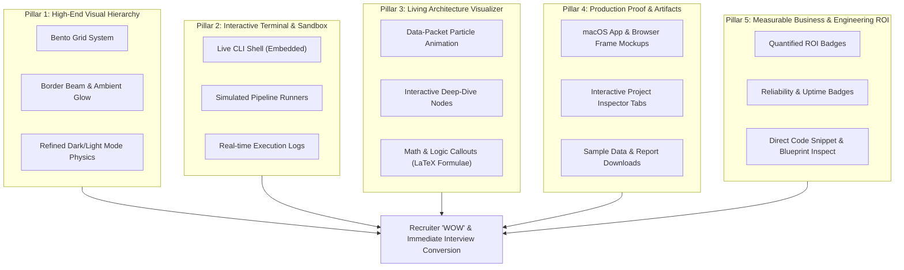
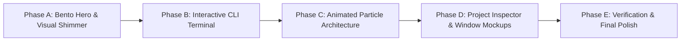

# 💎 MASTER "WOW-FACTOR" TRANSFORMATION PLAN
## Elevating Nguyen Quoc Minh's Engineering Portfolio to Silicon Valley Standard

> **Target Audience:** Tech Leads, Quantitative Finance Directors, Senior Engineering Hiring Managers & Executive Recruiters.  
> **Core Objective:** Transition the portfolio from a standard clean dashboard to an immersive, authoritative engineering platform that proves architectural depth, production rigor, and quantifiable business ROI within 10 seconds of landing.

---

## 🧭 Executive Summary & Gap Analysis

| Dimension | Current State ("Solid Baseline") | Target State ("Silicon Valley WOW-Factor") |
| :--- | :--- | :--- |
| **Visual Aesthetic** | Clean, flat SaaS blue palette (#102A56), standard cards | **Linear/Stripe-tier Engineering Polish:** Dynamic ambient glow, subtle grain texture, gradient border-beams, Bento grid layout |
| **Visual Proof ("Show Don't Tell")** | Flat icon placeholders, abstract SVG sketches | **Realistic macOS/Browser Window Mockups:** Interactive tabbed view (Live UI Mockup, Real Execution CLI Terminal, Raw Data JSON/Excel viewer) |
| **System Architecture** | Static stepped rectangles with dashed arrows | **Animated Data-Packet Flow:** Glowing particle pulses traveling along pipeline paths, interactive clickable nodes with deep-dive technical specs |
| **Quant & Financial Rigor** | Textual mention of Sharpe ratio & Monte Carlo | **Interactive In-Browser CLI Terminal & Quant Sandbox:** HR can click/type commands (`run cashew-ocr`, `calc sharpe --fund DCDS`) to see real pipeline simulation |
| **Proof of Work & Output** | High-level lists of achievements | **Downloadable & Inspectable Artifacts:** One-click preview of actual generated Excel multi-sheet workbooks, manifest JSONs, and audit reports |
| **Recruiter UX (Fast Scannability)** | Long scroll with even layout weight | **Executive "At-a-Glance" Bento Hero:** Highlights key badges (Production Uptime, Total Records Processed, Core Specialization) immediately |

---

## 🏛️ The 5 Strategic Pillars of WOW

---

## 🔨 Detailed Pillar Specifications

### Pillar 1: High-End Visual Polish (Bento Grid & Ambient Lighting)
1. **Hero Section Redesign (Bento Layout):**
   - **Main Showcase Cell (60% width):** High-impact interactive terminal or flagship project live preview (`XNK Cashew Data Platform`).
   - **Metric Cells (40% width):** Compact glowing metric tiles with micro-sparklines (e.g., `84+ Months Ingested`, `100K GPU Monte Carlo Paths`, `99.9% Token Uptime`).
   - **Status Pill:** Live beacon indicator with real-time UTC/GMT clock, giving an active engineering feel.
2. **Border-Beam & Shimmer Effects:**
   - Active cards and primary buttons feature a subtle rotating gradient light along their borders on hover.
   - Refined depth with multi-layered drop shadows (`box-shadow: 0 0 0 1px rgba(255,255,255,0.08), 0 20px 40px -15px rgba(0,0,0,0.5)`).

### Pillar 2: Interactive In-Browser Engineering CLI Terminal
1. **The "Live Terminal" Component (`#recruiter-terminal`):**
   - Positioned in the Hero or Engineering Lab section.
   - Features quick-click pre-set commands so recruiters don't need to type:
     - `▶ run xnk-ocr --period 2026-09` $\rightarrow$ Simulates Playwright browser fetch, PDF text block parsing, mathematical fallback estimation, and Excel sheet compilation with colorized stdout logs.
     - `▶ eval fund-risk --fund DCDS` $\rightarrow$ Simulates PyTorch CUDA Sharpe ratio & Monte Carlo 252-day distribution matrix.
     - `▶ test token-health --platform meta` $\rightarrow$ Simulates OAuth token lifespan audit and self-healing exchange logic.
     - `▶ help` $\rightarrow$ Displays available commands.
2. **Why HR Loves This:** It proves you actually understand lower-level tooling, command-line operations, and asynchronous backend systems, instantly separating you from frontend-only developers.

### Pillar 3: Living Architecture Visualizer (Pulse & Particles)
1. **Animated Data Flow SVG:**
   - Instead of static arrows, CSS/SVG keyframe animations render glowing "data packets" traversing from data sources $\rightarrow$ scrapers $\rightarrow$ processing nodes $\rightarrow$ database $\rightarrow$ UI dashboards.
2. **Interactive Node Inspector:**
   - Clicking a node (e.g. `OCR Engine & Fallback Logic`) opens a side drawer or modal displaying:
     - The mathematical formula: $Q_M = \frac{Q_{M+1}}{1 + \frac{\%\Delta Q_{M+1}}{100}}$
     - Why this technical decision was chosen over alternatives (e.g., *Why PaddleOCR + pdfplumber hybrid vs single Tesseract*).
     - Error handling strategy (handling corrupted scanned PDFs).

### Pillar 4: Production Mockups & Artifact Inspector
1. **Browser & Terminal Window Frames:**
   - Wrap each project card or detail view in a sleek dark-mode window with macOS window controls (`🔴 🟡 🟢`) and clean URL bar indicators (`https://tchq.analytics.internal/dashboard`).
2. **Project Detail Inspector Tabs:**
   - Every project detail view includes 3 switchable preview modes:
     - **Tab 1: Interactive UI Mockup:** Visual dashboard preview with mock interactive filters.
     - **Tab 2: Execution Trace / Logs:** Exact terminal output showing log levels (`INFO`, `DEBUG`, `SUCCESS`), execution timestamps, and latency benchmarks.
     - **Tab 3: Output Schema & Data Sample:** Formatted JSON tree viewer or mini Excel table showing the exact clean schema produced.
3. **Downloadable Sample Artifacts:**
   - Direct button to inspect/download a sanitized real sample output (e.g., `sample_manifest.json` or `sample_cashew_metrics.xlsx`).

### Pillar 5: Quantified Engineering & Business ROI
1. **Explicit Metric Ribbons on Cards:**
   - **XNK Cashew:** `84 Monthly Periods` · `98.5% Extraction Accuracy` · `6 Export Formats`
   - **SEE Content Connector:** `15-Min Live Sync` · `Zero Token Expiry Incidents` · `1-Click IaC Deploy`
   - **SEE Notion Bot:** `46 Unit Tests` · `<1.2s Response Latency` · `0 Duplicate Pings`
   - **Dragon Capital Fund:** `2,000+ Files Processed` · `100,000 Monte Carlo Paths` · `GPU Accelerated`
2. **"Under The Hood" Code Peeking:**
   - Interactive syntax-highlighted code drawer showing clean, production-grade snippets of critical algorithms (e.g., the self-healing token swap function or the multi-process Excel reader).

---

## 🗓️ Phased Implementation Roadmap

### Phase A: Visual Overhaul & Bento Grid System
- [ ] Add linear/glow CSS utilities (`.border-beam`, `.glow-card`, `.bento-grid`, `.ambient-blur`).
- [ ] Refactor Hero into an asymmetrical Bento grid (Headline + Terminal/Previewer + Stat counters + Live beacon).
- [ ] Elevate dark and light theme token contrast for crisp readability.
- **Verification:** Browser rendering check across desktop and mobile.

### Phase B: Interactive Recruiter Terminal Sandbox
- [ ] Create `js/terminal.js` module with command runner and typed log simulation.
- [ ] Embed the terminal directly into the Hero or Engineering Lab section.
- [ ] Add interactive 1-click execution chips (`Cashew OCR Pipeline`, `Fund Risk Simulation`, `Token Health Check`).
- **Verification:** Execute every command and verify realistic response delay, colorized logs, and reset behavior.

### Phase C: Living Architecture Visualizer
- [ ] Upgrade the 6 project architecture diagrams in `js/projects.js` to SVG particle flow pipelines.
- [ ] Implement click-to-expand deep-dive popovers on key architecture nodes.
- **Verification:** Test SVG stroke-dashoffset animations across Chrome, Edge, and Safari; verify performance on lower-power devices.

### Phase D: macOS Window Mockups & Project Detail Tabs
- [ ] Implement `.window-frame` CSS components with realistic title bar and controls.
- [ ] Add the 3-tab inspector (Preview / Console Logs / Data Output) to project cards and project detail pages.
- [ ] Provide sample JSON schemas and simulated Excel tables directly in the UI.
- **Verification:** Verify tab switching persistence, responsive scaling, and smooth transitions.

### Phase E: Verification, Performance & Recruiter Polish
- [ ] Run Lighthouse audit to ensure 95+ performance, accessibility, and SEO scores.
- [ ] Test prefers-reduced-motion compatibility (smoothly disable particles and loops if requested).
- [ ] Perform full cross-browser check (Chrome, Edge, Firefox, Mobile Safari).

---

## 🎯 Definition of Done for "WOW" Experience

When an HR professional or Tech Lead lands on the portfolio:
1. **Within 3 seconds:** The glowing Bento Hero and live beacon immediately signal top-tier frontend taste.
2. **Within 10 seconds:** Clicking a button on the interactive CLI terminal shows live streaming logs of an OCR or Financial simulation, proving backend competency.
3. **Within 30 seconds:** Inspecting a project detail page reveals an animated data-packet architecture flow and downloadable/inspectable structured output, proving you build end-to-end production systems, not toy projects.
